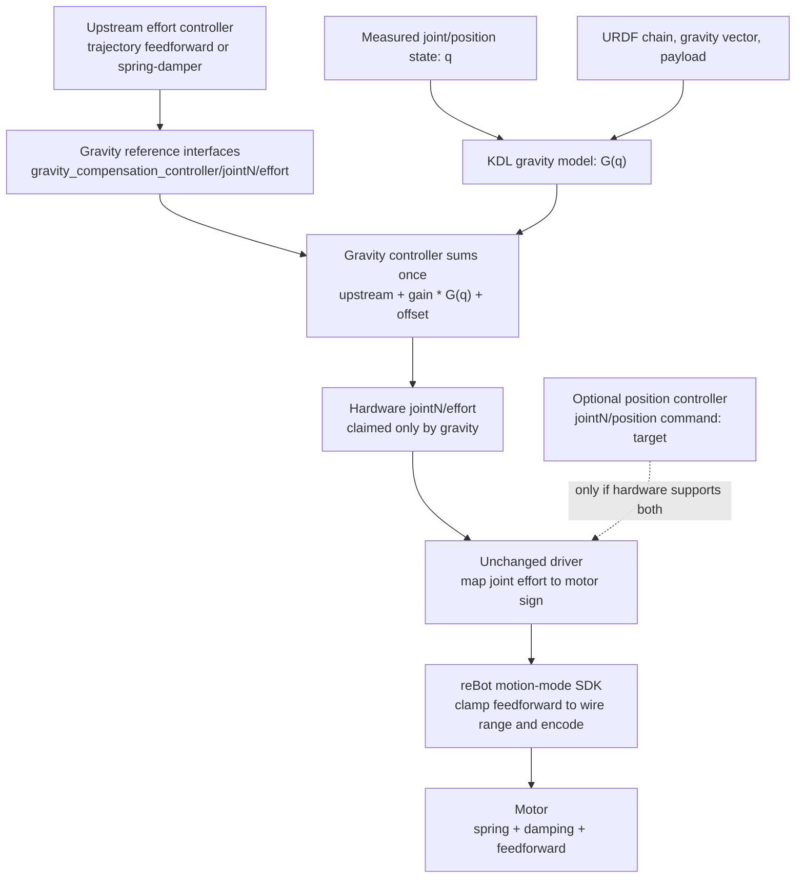
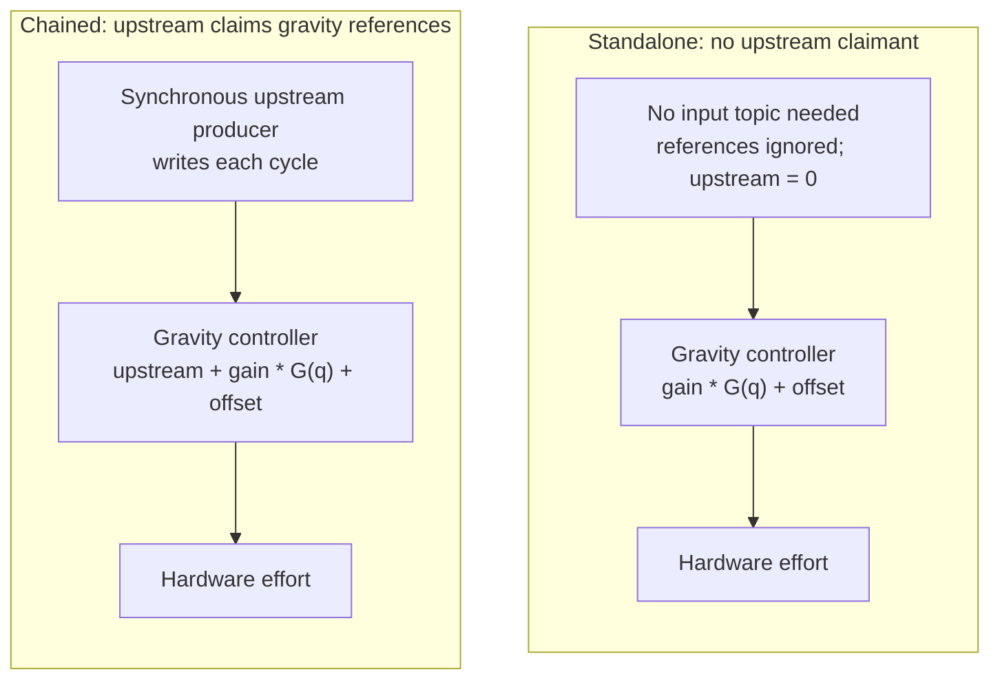
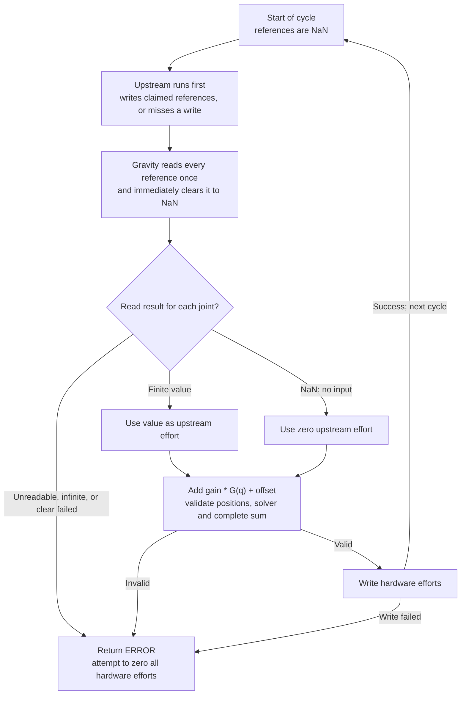

# KDL gravity compensation controller

A ros2_control **chainable** downstream controller for a URDF serial chain.
It adds model-based gravity effort to an upstream effort command, or runs by
itself as gravity-only.

## Why a soft spring sags under load

A joint in spring/impedance mode needs position error to generate spring torque.
For a revolute joint, the idealized motor law is:

```text
torque = kp * (desired position - measured position)
       + kd * (desired velocity - measured velocity) + feedforward torque
```

At rest with a stationary target, damping contributes nothing. For positive
stiffness `kp`, the local, unsaturated balance is approximately:

```text
position error = (load torque - feedforward torque) / kp
```

Without feedforward, a soft spring must deflect to carry the arm's weight.
Increasing stiffness reduces that error but also makes the joint less compliant.
Gravity feedforward instead estimates the predictable load so the spring does
not have to provide all the holding torque through sag. This is an equilibrium
approximation, not a guarantee through friction, contact, saturation or motion.
Model errors still leave a residual load for the spring to carry.

This motivation applies to spring/impedance mode, not every position controller.
The reBot configuration still defaults to mock hardware and `position_csp`;
its optional effort path requires explicitly selected real motion mode. Nothing
in this package changes those defaults or enables motors.

## Follow the position and effort paths

The controller reads **measured** joint positions `q`, not the position target,
and writes, per joint:

```text
hardware effort = upstream effort + gains[i] * gravity(q)[i] + offsets[i]
```

Gravity comes from KDL `ChainDynParam::JntToGravity`, using the URDF chain,
gravity vector and optional payload. Gains and offsets apply only to the
gravity contribution, never to upstream effort. An upstream producer should
supply the remaining effort, not a second copy of the same gravity term.



**Commands ask; states report.** A `joint/position` command holds a desired
position; its separate state interface reports the measured position. The
gravity reference is another command interface, written by an upstream
controller rather than hardware. It is not a topic or a torque measurement.
The last three boxes illustrate reBot's motion-mode path; other effort drivers
have their own command interpretation and limits.

### What the unchanged driver does, and does not, limit

In reBot motion mode, the [driver's `write()`](../external_dependencies/robstride_hardware_interface/robstride_hardware_interface/src/robstride_hardware_interface.cpp)
maps the summed joint effort to motor sign and passes it to
[`EncodeMotionCommand`](../external_dependencies/robstride_sdk/robstride_sdk/include/robstride_sdk/robstride_motor.hpp).
The SDK's [`FloatToUint16`](../external_dependencies/robstride_sdk/robstride_sdk/include/robstride_sdk/robstride_protocol.hpp)
clamps and quantizes that feedforward field to the motor model's wire range.
The diagram shows the normal command path; existing freeze/fault handling can
suppress it. CSP takes a different branch and writes a position target, not
this feedforward field.

There is **no added controller clamp or separate driver feedforward cap** here.
A historical optional driver-side `max_feedforward_effort` clamp is not part
of this implementation. Do not confuse that separate policy, a URDF effort
limit, or the SDK's encoding range with a certified continuous-hold limit.
Clamping the feedforward field does not bound the motor's total spring +
damping + feedforward torque. `~/commanded_effort` reports the sum **before**
driver/SDK limiting, not measured motor torque or proof of physical balance.

## Why the gravity model belongs in a chainable controller

The controller owns the robot-specific chain, payload, mounting gravity and
trim; the driver keeps its existing transport and motor-command mapping.
Putting the model in the driver would couple those robot assumptions to a
hardware plugin and require another way to configure and test them. Here the
same plugin can be exercised with fake hardware, using the normal lifecycle
and parameter APIs, without changing driver code.

ros2_control gives each command interface one claimant. Two controllers cannot
both write hardware `joint/effort`, even if the intent is to add their torques.
Chaining makes the addition explicit: the upstream controller claims gravity's
references; gravity alone claims hardware effort. Controller manager handles
those claims and orders upstream before gravity. No new mux, bridge or driver
mixing policy is needed. This controller adds gravity once per update; it does
not accumulate commands, change motor gains or torque limits, or supply motion
control and safety policy.

## Interfaces and ownership

Plugin: `kdl_gravity_compensation_controller/GravityCompensationController`.
Requires ROS 2 Jazzy `controller_interface` **4.45.2 or newer** (shared-pointer
`on_export_reference_interfaces_list()` API). The plugin base is now
`controller_interface::ChainableControllerInterface`, rather than
`ControllerInterface`; the plugin name and gravity parameters are unchanged.

For `joints: [joint1, joint2]` and controller name
`gravity_compensation_controller`:

| Role | Interfaces, in configured joint order |
| --- | --- |
| Hardware command claims | `joint1/effort`, `joint2/effort` |
| Hardware state reads | `joint1/position`, `joint2/position` |
| Exported upstream command references | `gravity_compensation_controller/joint1/effort`, `gravity_compensation_controller/joint2/effort` |

All values are doubles, in the URDF joint frame (effort in Nm for revolute
joints, N for prismatic joints). `joints` must contain exactly the movable
joints from root to tip, in chain order. Hardware loans are mapped by name;
no hardware declaration order is assumed. No state interfaces are exported.

**Gravity is the sole hardware effort writer.** An upstream effort producer
claims the exported names, not `joint1/effort` concurrently. A position
controller can coexist only if the hardware supports simultaneous position
and effort commands. An effort-only driver needs only the downstream effort
claim. This controller does not turn a position-only driver into an effort
driver, and it does not provide position holding, damping or trajectory control.

## Standalone versus chained operation

Both modes use the same measured positions, gravity model and hardware effort
claims. Only the source of the upstream term changes:



Controller manager selects chained mode when an upstream controller claims the
references. Deactivating that upstream controller through controller manager
returns gravity to standalone. Mode/lifecycle changes clear references; do not
switch a loaded robot on the assumption that zero effort is a safe hold.

### Standalone gravity-only setup

Add the plugin type and parameters to a controller manager's configuration:

```yaml
controller_manager:
  ros__parameters:
    update_rate: 100
    gravity_compensation_controller:
      type: kdl_gravity_compensation_controller/GravityCompensationController

gravity_compensation_controller:
  ros__parameters:
    joints: [joint1, joint2]
    root_link: base_link
    tip_link: tool0
    gravity_vector: [0.0, 0.0, -9.81]
    payload_mass: 0.0
    payload_com: [0.0, 0.0, 0.0]
    gains: [0.0, 0.0]
    offsets: [0.0, 0.0]
```

Use the actual URDF chain and declare each joint's `effort` command and
`position` state in its `<ros2_control>` block. The robot description is
provided by controller manager, not by a separate controller parameter.
Load/configure the controller **inactive** first:

```bash
ros2 run controller_manager spawner gravity_compensation_controller --inactive
```

In a private fake-hardware setup, activating only this controller exercises
standalone operation:

```bash
ros2 control switch_controllers --activate gravity_compensation_controller --strict
```

No upstream producer or input topic is needed. Standalone always uses zero
upstream effort. The example's explicit zero gains/offsets produce zero output;
nonzero gravity requires deliberate configuration and commissioning. The
library preserves the original parameter default of unit gains when `gains`
is omitted, so **do not omit gains to disable gravity**.

### Chaining an upstream effort controller

Configure the upstream controller's command interface names to use the exported
references. For example, the standard `forward_command_controller` can forward
an effort array in a fake-hardware test:

```yaml
controller_manager:
  ros__parameters:
    upstream_effort:
      type: forward_command_controller/ForwardCommandController

upstream_effort:
  ros__parameters:
    joints:
      - gravity_compensation_controller/joint1
      - gravity_compensation_controller/joint2
    interface_name: effort
```

Merge that with the gravity configuration above. Load/configure gravity first,
then the upstream controller. In a private fake-hardware setup:

```bash
ros2 run controller_manager spawner upstream_effort --inactive
ros2 control switch_controllers --activate gravity_compensation_controller upstream_effort --strict
ros2 topic pub --once /upstream_effort/commands std_msgs/msg/Float64MultiArray '{data: [0.2, -0.1]}'
```

Controller manager makes gravity's references available, enters chained mode,
loans the references to the upstream controller, and activates the requested
controllers before their first update. It schedules **upstream before gravity**
on update; activation order within a switch request is not update order.
**Producers must write every claimed reference on every gravity cycle**,
synchronously at gravity's update rate. Each update consumes the references and
clears them to NaN, so a skipped cycle contributes zero effort, not the last
value; asynchronous/multi-rate producers are not supported. A trajectory or
spring-mass-damper controller must likewise support separate command-interface
names; adding another direct hardware `effort` claimant is not chaining. No
production upstream controller is added by this package.

The forward controller is only an interface example, not a safe motion
controller: it holds its last array and provides no command timeout, damping,
position/velocity limits or collision checking. Commands above are for fake
hardware only. Use a commissioned effort producer and hardware-specific safety
procedures on a real robot.

## Every cycle consumes and clears its input

References are single-cycle inputs, not a hold-last-command buffer. NaN means
**no upstream input this cycle**, so that joint gets zero upstream effort while
its gravity contribution remains. A valid zero is also accepted. An unreadable
handle is a different failure: it is not treated as a missing command.



Clearing happens even on failed updates, before any error return. Thus a
six-joint producer replaced by a three-joint producer cannot leave its old
commands on the released joints: those three references stay NaN and contribute
zero next cycle. The replacement must still write its three claimed references
every cycle. This rule prevents stale **reference** reuse; it does not detect
stale commands inside an upstream controller that keeps rewriting its last
value (as the forward-controller example does).

## Lifecycle, missing data and diagnostics

- Reference handles start as NaN, the standard ros2_control "no command"
  value. Activation, deactivation and chained-mode switches clear them too.
  Standalone clears and ignores all upstream references on every update.
- Controller manager performs mode switches while gravity is inactive. To
  return to standalone, deactivate the upstream controller through controller
  manager; to stop the chain, deactivate upstream and gravity together. It
  rejects stopping gravity alone while an upstream claimant remains active.
- Swapping producers within one switch, including to one that claims fewer
  joints, leaves no effort behind on released joints: they read NaN on the
  next update.
- Activation requires finite measured positions and complete, correctly named
  double interfaces. Missing/non-finite positions, unreadable or infinite
  references, solver errors, non-finite output (including arithmetic
  overflow), and failed command writes return `ERROR`. Invalid updates attempt
  to zero **all** hardware efforts and do not publish a successful output. A failed zero write is still an error,
  not evidence that hardware reached zero. Controller manager handles error
  deactivation of the chain.
- Deactivation and shutdown attempt to zero effort. **Zero effort is not a
  gravity-loaded arm's safe hold.** Support the load and follow the robot's
  stopping procedure before controller switches or deactivation; no ramp,
  automatic hold, thermal policy or safety-rated stop is supplied here.

`~/commanded_effort` (`sensor_msgs/msg/JointState`) reports the measured
positions used and the **summed** effort requested at a successful update, in
`joints` order. It is not a motor-torque measurement or post-driver-limit
readback. Publication is best-effort realtime and may skip samples.

### Parameters

| Parameter | Default | Applied |
| --- | --- | --- |
| `joints` | empty, must be set | configure |
| `root_link` | `base_link` | configure |
| `tip_link` | empty, must be set | configure |
| `gravity_vector` | `[0.0, 0.0, -9.81]` m/s² in root frame | configure |
| `payload_mass` | `0.0` kg; finite and nonnegative | configure |
| `payload_com` | `[0.0, 0.0, 0.0]` m in tip frame | configure |
| `gains` | one per joint; empty means all `1.0` on configure | live |
| `offsets` | one per joint; empty means all `0.0` on configure | live |

Live gains/offsets must have one finite value per joint; rejected parameter
transactions leave both the parameters and realtime trim unchanged. Other
parameters require cleanup/reconfigure to take effect. Gravity and payload
vectors must have three finite values. Payload is added to the tip's existing
inertia; do not count a payload already in the URDF twice. Use the gravity
vector for mount orientation. The serial chain does not automatically include
masses on branches outside root-to-tip.

Compared with the earlier standalone controller, unreadable position no longer
returns `OK` with the previous torque. It returns `ERROR`, as do non-finite
inputs/outputs. This is intentional failure reporting, not a new hardware
safety policy.

## Tests

With this workspace and its dependencies sourced:

```bash
colcon build --packages-select kdl_gravity_compensation_controller
source install/setup.bash
colcon test --packages-select kdl_gravity_compensation_controller
colcon test-result --verbose
```

`test_gravity_model` compares KDL with hand-derived planar-arm torques, payloads
and mount orientation. `test_gravity_compensation_controller` uses real loaned
interfaces to exercise ordering, reference resets, live trim, finite/missing
inputs and failed writes. `test_controller_chaining` loads the plugin into a
real `ControllerManager` with `mock_components/GenericSystem` and a test-only
upstream producer, on two- and six-joint test arms. It checks reference
ownership, claim conflicts, activation and update ordering, nonzero varying
inputs, partial-joint references, a six-to-three-joint producer swap, missed
writes, summed hardware output, standalone operation, lifecycle transitions and
error recovery.
No test opens a device, uses CAN, or launches a MoveIt Pro deployment. These are
software composition tests, not a physical balance or safety certification.
