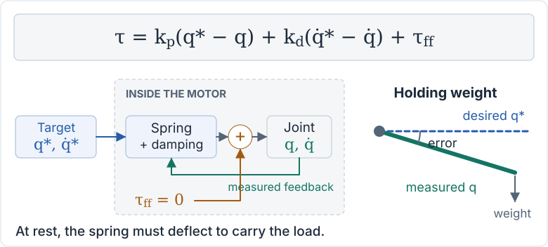
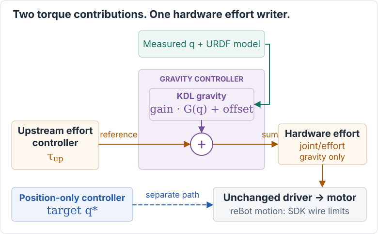
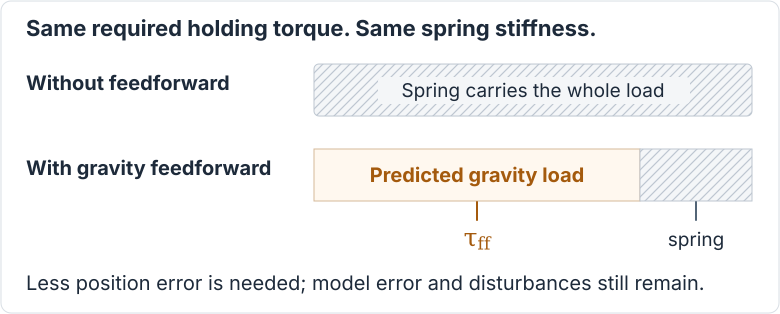

# KDL gravity compensation controller

**Let gravity feedforward carry the predictable load, not the position error.**
This ros2_control chainable controller adds model-based gravity effort to an
upstream effort command. With no upstream controller, it runs gravity-only.

## 1. Why does a soft spring sag?

In spring/impedance mode, a joint must deflect to produce spring torque. At rest,
damping contributes nothing: without feedforward, position error carries the
weight. More stiffness reduces sag, but also makes the joint less compliant.

<picture>
  <source media="(prefers-color-scheme: dark) and (max-width: 600px)" srcset="docs/figures/spring-sag-dark-mobile.svg">
  <source media="(prefers-color-scheme: dark)" srcset="docs/figures/spring-sag-dark.svg">
  <source media="(max-width: 600px)" srcset="docs/figures/spring-sag-light-mobile.svg">
  
</picture>

*At a stationary target, q\* is the desired angle and q is the measured angle.
The sag sketch is illustrative: a local, unsaturated equilibrium, not a measurement.*

## 2. Where does the gravity controller sit?

Two controllers cannot both claim hardware `joint/effort`. Instead, the upstream
effort controller writes **gravity's reference**; gravity adds its contribution
and is the **only hardware effort writer**. Controller manager runs upstream
before gravity, with no topic round-trip between them.

<picture>
  <source media="(prefers-color-scheme: dark) and (max-width: 600px)" srcset="docs/figures/effort-chain-dark-mobile.svg">
  <source media="(prefers-color-scheme: dark)" srcset="docs/figures/effort-chain-dark.svg">
  <source media="(max-width: 600px)" srcset="docs/figures/effort-chain-light-mobile.svg">
  
</picture>

*Orange: effort. Purple: gravity model. Green: measured position. Dashed blue:
separate position target, only on hardware that supports both command types.*

Per joint, the [controller](src/gravity_compensation_controller.cpp) writes:

```text
hardware effort = upstream effort + gains[i] * gravity(q)[i] + offsets[i]
```

The model uses **measured q**, the URDF chain, mounting gravity and optional
payload. Gains never scale upstream effort; do not add the same gravity term
again upstream. Keeping the model here makes its parameters, lifecycle and
fake-hardware tests independent of the driver. A position-only jog or trajectory
controller is **not** an upstream effort producer.

## 3. What does feedforward take off the spring?

It supplies the **predicted gravity load**, reducing the torque the spring must
create through position error. It does not remove model error, friction,
contact forces or the need for damping.

<picture>
  <source media="(prefers-color-scheme: dark) and (max-width: 600px)" srcset="docs/figures/feedforward-benefit-dark-mobile.svg">
  <source media="(prefers-color-scheme: dark)" srcset="docs/figures/feedforward-benefit-dark.svg">
  <source media="(max-width: 600px)" srcset="docs/figures/feedforward-benefit-light-mobile.svg">
  
</picture>

*Equal bars: the same required holding torque. Orange is feedforward; hatching
is the spring's remaining job. Proportions are illustrative, not measured.*

Locally at rest, with positive stiffness and no saturation:
**q\* − q ≈ (τ<sub>load</sub> − τ<sub>ff</sub>) / k<sub>p</sub>**.
A better gravity estimate can reduce sag without increasing stiffness; it is
not a guarantee of physical balance or safe hold.

### What stays in the driver?

In reBot motion mode, the unchanged [driver](../external_dependencies/robstride_hardware_interface/robstride_hardware_interface/src/robstride_hardware_interface.cpp)
maps the summed effort to motor sign. The SDK
[encodes](../external_dependencies/robstride_sdk/robstride_sdk/include/robstride_sdk/robstride_motor.hpp)
and [clamps](../external_dependencies/robstride_sdk/robstride_sdk/include/robstride_sdk/robstride_protocol.hpp)
feedforward to its motor-model wire range. Existing freeze/fault handling can
suppress commands; CSP uses a separate position-target path.

**No controller clamp or separate driver feedforward cap is added.** The
historical optional `max_feedforward_effort` cap is not included. Wire ranges
are not continuous-hold ratings and do not bound total spring + damping +
feedforward torque. `~/commanded_effort` is the **pre-limit request**, not
measured motor torque.

The reBot configuration still defaults to mock hardware and `position_csp`.
The optional effort path requires explicitly selected real motion mode; gravity
starts inactive with zero configured gains/offsets. Nothing here enables motors
or changes gains, limits or motion policy.

## Interfaces and ownership

Plugin: `kdl_gravity_compensation_controller/GravityCompensationController`.
Requires ROS 2 Jazzy `controller_interface` **4.45.2 or newer** (shared-pointer
`on_export_reference_interfaces_list()` API). The plugin base is now
`controller_interface::ChainableControllerInterface`, rather than
`ControllerInterface`; the plugin name and gravity parameters are unchanged.

For `joints: [joint1, joint2]` and controller name
`gravity_compensation_controller`:

| Role | Interfaces, in configured joint order |
| --- | --- |
| Hardware command claims | `joint1/effort`, `joint2/effort` |
| Hardware state reads | `joint1/position`, `joint2/position` |
| Exported upstream command references | `gravity_compensation_controller/joint1/effort`, `gravity_compensation_controller/joint2/effort` |

All values are doubles, in the URDF joint frame (effort in Nm for revolute
joints, N for prismatic joints). `joints` must contain exactly the movable
joints from root to tip, in chain order. Hardware loans are mapped by name;
no hardware declaration order is assumed. No state interfaces are exported.

**Gravity is the sole hardware effort writer.** An upstream effort producer
claims the exported names, not `joint1/effort` concurrently. A position
controller can coexist only if the hardware supports simultaneous position
and effort commands. An effort-only driver needs only the downstream effort
claim. This controller does not turn a position-only driver into an effort
driver, and it does not provide position holding, damping or trajectory control.

## Standalone versus chained operation

- **Standalone:** upstream effort is zero; references are ignored. No input topic
  is needed. Output is `gain * G(q) + offset`.
- **Chained:** a synchronous upstream producer writes gravity's references each
  cycle. Output is `upstream + gain * G(q) + offset`.

Gravity has the same hardware claims in both modes. Controller manager selects
chained mode when an upstream controller claims references; deactivating that
producer returns gravity to standalone. Lifecycle/mode changes clear references.
**Zero effort is not a loaded arm's safe hold.**

### Standalone gravity-only setup

Add the plugin type and parameters to a controller manager's configuration:

```yaml
controller_manager:
  ros__parameters:
    update_rate: 100
    gravity_compensation_controller:
      type: kdl_gravity_compensation_controller/GravityCompensationController

gravity_compensation_controller:
  ros__parameters:
    joints: [joint1, joint2]
    root_link: base_link
    tip_link: tool0
    gravity_vector: [0.0, 0.0, -9.81]
    payload_mass: 0.0
    payload_com: [0.0, 0.0, 0.0]
    gains: [0.0, 0.0]
    offsets: [0.0, 0.0]
```

Use the actual URDF chain and declare each joint's `effort` command and
`position` state in its `<ros2_control>` block. The robot description is
provided by controller manager, not by a separate controller parameter.
Load/configure the controller **inactive** first:

```bash
ros2 run controller_manager spawner gravity_compensation_controller --inactive
```

In a private fake-hardware setup, activating only this controller exercises
standalone operation:

```bash
ros2 control switch_controllers --activate gravity_compensation_controller --strict
```

No upstream producer or input topic is needed. Standalone always uses zero
upstream effort. The example's explicit zero gains/offsets produce zero output;
nonzero gravity requires deliberate configuration and commissioning. The
library preserves the original parameter default of unit gains when `gains`
is omitted, so **do not omit gains to disable gravity**.

### Chaining an upstream effort controller

Configure the upstream controller's command interface names to use the exported
references. For example, the standard `forward_command_controller` can forward
an effort array in a fake-hardware test:

```yaml
controller_manager:
  ros__parameters:
    upstream_effort:
      type: forward_command_controller/ForwardCommandController

upstream_effort:
  ros__parameters:
    joints:
      - gravity_compensation_controller/joint1
      - gravity_compensation_controller/joint2
    interface_name: effort
```

Merge that with the gravity configuration above. Load/configure gravity first,
then the upstream controller. In a private fake-hardware setup:

```bash
ros2 run controller_manager spawner upstream_effort --inactive
ros2 control switch_controllers --activate gravity_compensation_controller upstream_effort --strict
ros2 topic pub --once /upstream_effort/commands std_msgs/msg/Float64MultiArray '{data: [0.2, -0.1]}'
```

Controller manager makes gravity's references available, enters chained mode,
loans the references to the upstream controller, and activates the requested
controllers before their first update. It schedules **upstream before gravity**
on update; activation order within a switch request is not update order.
**Producers must write every claimed reference on every gravity cycle**,
synchronously at gravity's update rate. Each update consumes the references and
clears them to NaN, so a skipped cycle contributes zero effort, not the last
value; asynchronous/multi-rate producers are not supported. A trajectory or
spring-mass-damper controller must likewise support separate command-interface
names; adding another direct hardware `effort` claimant is not chaining. No
production upstream controller is added by this package.

The forward controller is only an interface example, not a safe motion
controller: it holds its last array and provides no command timeout, damping,
position/velocity limits or collision checking. Commands above are for fake
hardware only. Use a commissioned effort producer and hardware-specific safety
procedures on a real robot.

## Every cycle consumes and clears its input

**Write → read once → clear to NaN → add gravity.** References are single-cycle
inputs, not a hold-last-command buffer. NaN means **no input this cycle**, so
that joint gets zero upstream effort while its gravity contribution remains.
Unreadable or infinite input is an error, not a missing command.

Clearing also happens on failed updates. A six-joint producer replaced by a
three-joint producer leaves no old effort on the released joints. Every claimed
reference must be rewritten each cycle; asynchronous/multi-rate producers are
unsupported. This prevents stale **reference** reuse, not stale data inside a
producer that keeps rewriting its last value.

## Lifecycle, missing data and diagnostics

- Reference handles start as NaN, the standard ros2_control "no command"
  value. Activation, deactivation and chained-mode switches clear them too.
  Standalone clears and ignores all upstream references on every update.
- Controller manager performs mode switches while gravity is inactive. To
  return to standalone, deactivate the upstream controller through controller
  manager; to stop the chain, deactivate upstream and gravity together. It
  rejects stopping gravity alone while an upstream claimant remains active.
- Swapping producers within one switch, including to one that claims fewer
  joints, leaves no effort behind on released joints: they read NaN on the
  next update.
- Activation requires finite measured positions and complete, correctly named
  double interfaces. Missing/non-finite positions, unreadable or infinite
  references, solver errors, non-finite output (including arithmetic
  overflow), and failed command writes return `ERROR`. Invalid updates attempt
  to zero **all** hardware efforts and do not publish a successful output. A failed zero write is still an error,
  not evidence that hardware reached zero. Controller manager handles error
  deactivation of the chain.
- Deactivation and shutdown attempt to zero effort. **Zero effort is not a
  gravity-loaded arm's safe hold.** Support the load and follow the robot's
  stopping procedure before controller switches or deactivation; no ramp,
  automatic hold, thermal policy or safety-rated stop is supplied here.

`~/commanded_effort` (`sensor_msgs/msg/JointState`) reports the measured
positions used and the **summed** effort requested at a successful update, in
`joints` order. It is not a motor-torque measurement or post-driver-limit
readback. Publication is best-effort realtime and may skip samples.

### Parameters

| Parameter | Default | Applied |
| --- | --- | --- |
| `joints` | empty, must be set | configure |
| `root_link` | `base_link` | configure |
| `tip_link` | empty, must be set | configure |
| `gravity_vector` | `[0.0, 0.0, -9.81]` m/s² in root frame | configure |
| `payload_mass` | `0.0` kg; finite and nonnegative | configure |
| `payload_com` | `[0.0, 0.0, 0.0]` m in tip frame | configure |
| `gains` | one per joint; empty means all `1.0` on configure | live |
| `offsets` | one per joint; empty means all `0.0` on configure | live |

Live gains/offsets must have one finite value per joint; rejected parameter
transactions leave both the parameters and realtime trim unchanged. Other
parameters require cleanup/reconfigure to take effect. Gravity and payload
vectors must have three finite values. Payload is added to the tip's existing
inertia; do not count a payload already in the URDF twice. Use the gravity
vector for mount orientation. The serial chain does not automatically include
masses on branches outside root-to-tip.

Compared with the earlier standalone controller, unreadable position no longer
returns `OK` with the previous torque. It returns `ERROR`, as do non-finite
inputs/outputs. This is intentional failure reporting, not a new hardware
safety policy.

## Tests

With this workspace and its dependencies sourced:

```bash
colcon build --packages-select kdl_gravity_compensation_controller
source install/setup.bash
colcon test --packages-select kdl_gravity_compensation_controller
colcon test-result --verbose
```

`test_gravity_model` compares KDL with hand-derived planar-arm torques, payloads
and mount orientation. `test_gravity_compensation_controller` uses real loaned
interfaces to exercise ordering, reference resets, live trim, finite/missing
inputs and failed writes. `test_controller_chaining` loads the plugin into a
real `ControllerManager` with `mock_components/GenericSystem` and a test-only
upstream producer, on two- and six-joint test arms. It checks reference
ownership, claim conflicts, activation and update ordering, nonzero varying
inputs, partial-joint references, a six-to-three-joint producer swap, missed
writes, summed hardware output, standalone operation, lifecycle transitions and
error recovery.
No test opens a device, uses CAN, or launches a MoveIt Pro deployment. These are
software composition tests, not a physical balance or safety certification.
